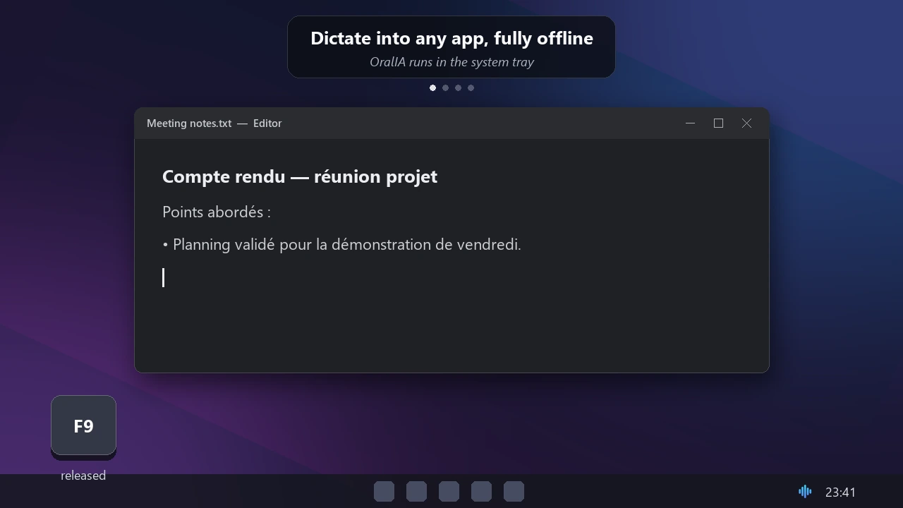
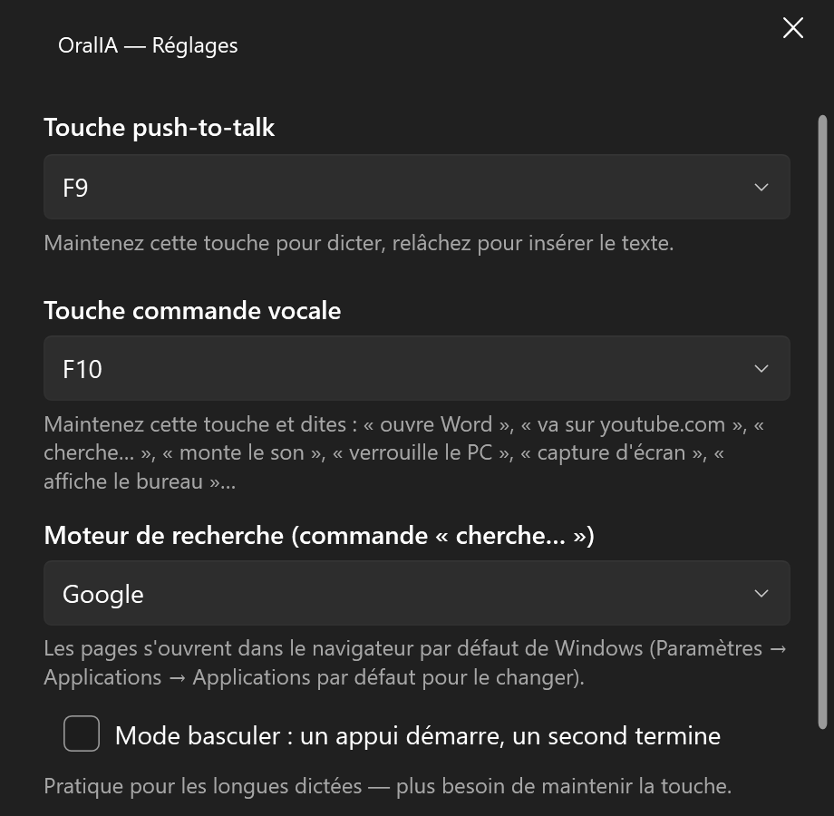
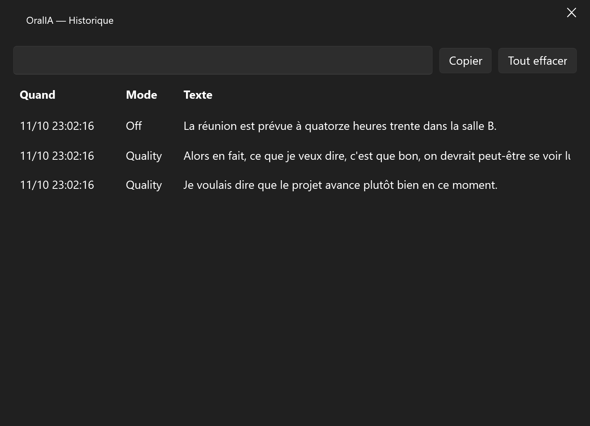
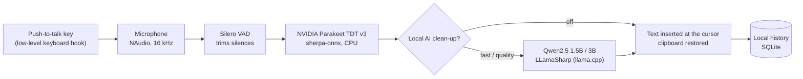

# OralIA

**Offline voice dictation for Windows: hold a key, speak, release, and the text is typed into any app. Speech recognition and AI clean-up run entirely on the computer, with no cloud, no account and no telemetry.**

> **This repository is a showcase.** The source code is private; I am happy to give a live demo
> or walk through the code in an interview. The interface is in French.

The dictation overlay frames come from the real app and the inserted sentence is the real output of the local model; the editor and desktop around them are a mock-up.

## What it does

- **Push-to-talk anywhere**: hold F9 in any application (browser, Word, chat, IDE), speak, release:
  the text is inserted at the cursor, and the clipboard is restored afterwards.
- **Fast on-device transcription**: NVIDIA Parakeet TDT v3 (25 European languages, French
  included) through sherpa-onnx, on the CPU, no GPU needed.
- **Optional local AI clean-up** with a small language model running on the computer (Qwen2.5,
  1.5B or 3B, via llama.cpp): fixes grammar, repetitions and self-corrections, formats dictated
  lists and line breaks.
- **Custom vocabulary**: names and technical terms are favoured by the recogniser (hotwords) and
  spelled correctly by the AI.
- **Voice commands** on a second key: "open Word", "go to youtube.com", "search for…", volume,
  screenshot, lock the PC, chained commands, plus user-defined commands. A closed catalogue of
  safe actions: never an arbitrary shell command.
- **Voice activity detection** (Silero VAD) to trim silences, a local history (SQLite) that can be
  searched or purged, start with Windows, an installer with automatic updates.

## Measured performance

Measured on a laptop CPU (no GPU), from the development log:

| Step | Result |
|---|---|
| Speech-to-text inference | 300–600 ms per dictation (200–400 ms in real use) |
| Real-time factor | 0.06–0.16 (a 10-second dictation is transcribed in under 2 s) |
| Speech model loading | about 1.8 s, once |
| AI clean-up, 3B model | loaded in about 15 s; first sentence about 9 s (warm-up), then 1.2–2.2 s per sentence |

## AI clean-up: real outputs

Produced by the app's own clean-up component with the local Qwen2.5 3B model, unedited:

| Raw transcription | After local AI clean-up |
|---|---|
| Je je voulais dire que le le projet avance plutôt bien en ce moment. | Je voulais dire que le projet avance plutôt bien en ce moment. |
| Alors en fait ce que je veux dire c'est que bon on devrait peut-être se voir lundi pour parler du budget enfin du budget marketing quoi. | Alors en fait, ce que je veux dire, c'est que bon, on devrait peut-être se voir lundi pour parler du budget marketing. |

Small local models are not perfect: some filler words remain, and a self-correction can
occasionally drop a detail. That is why the AI layer stays optional, and the raw transcription is
also stored in the history.

## Screens

| | |
|---|---|
|  |  |
| **Settings** (excerpt): push-to-talk key, voice-command key, search engine for voice searches, toggle mode | **History** (demo data): every dictation with its mode, searchable, copy, purge |

## Engineering highlights

- **Native Windows work through P/Invoke**: low-level keyboard hook for push-to-talk, an overlay
  that is click-through and never steals focus (`WS_EX_TRANSPARENT`, `WS_EX_NOACTIVATE`), text
  insertion with a clipboard fallback.
- **Latency-aware AI**: the prompt prefix is evaluated once and cached (KV cache) when the model
  loads, so each dictation only processes its own text; the AI model is not preloaded when the app
  starts with Windows, to save memory.
- **Built to be tested**: 106 xUnit tests (command grammar, key filtering, services, and
  integration tests that load the real models); MVVM with dependency injection; structured logs.
- **Shipping**: Velopack installer and delta updates, self-signed releases, models downloaded on first
  launch with progress (about 650 MB, plus about 3 GB for the optional AI models).
- **Privacy by design**: audio, text, settings and history never leave the computer.

## Architecture

| Layer | Technologies |
|---|---|
| App | C#, .NET 10, WPF with WPF-UI (Fluent design), MVVM (CommunityToolkit.Mvvm), Microsoft.Extensions.Hosting |
| Speech | sherpa-onnx, NVIDIA Parakeet TDT 0.6B v3 (int8), Silero VAD, NAudio |
| AI | LLamaSharp (llama.cpp), Qwen2.5 1.5B / 3B instruct (GGUF, Q4_K_M) |
| Data | SQLite (history), JSON settings, Serilog logs |
| Distribution | Velopack installer and updates |

## How it was built

I designed the app from a written specification and directed its development with an AI coding
assistant (Claude Code), validating each step on real hardware before the next one: a console spike
to measure transcription latency first, then push-to-talk, text insertion, the overlay, the tray
app and finally the local AI layer. All the code is original.

## Contact

Nayl Saifoudine · [LinkedIn](https://www.linkedin.com/in/nayl-saifoudine-5b0b31300/) ·
[other projects](https://github.com/Nayl-git)
